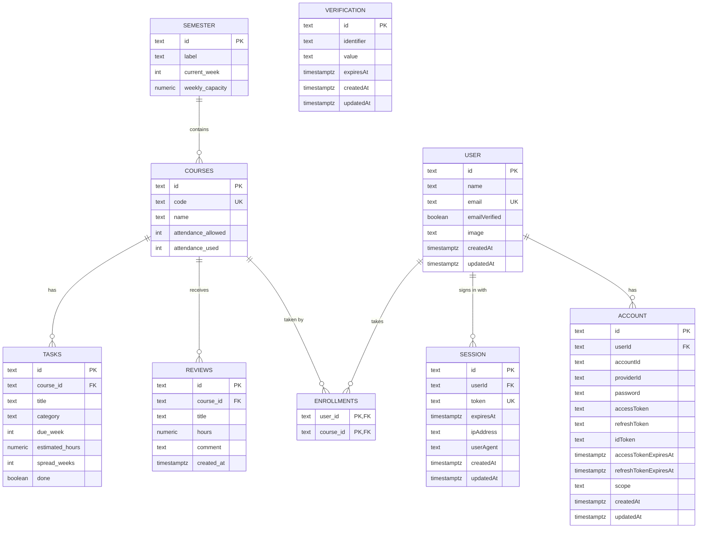

# Crunch Week — Database Design (SD2)

This is the database design deliverable for the Project Implementation grade.
It describes the tables, columns, keys and rules for the Crunch Week database,
which runs on **Postgres via Supabase**.

The design is deliberately scoped to what the app and API send today. The four
live tables (`semester`, `courses`, `tasks`, `reviews`) can be traced to a field
in `server/src/types.ts` (`Semester`, `Course`, `Task`, `Review`) or to the
validation in the server (`server/src/app.ts`) and the client
(`client/src/lib/`). The login tables come from Better Auth (see
[3.5](#35-login-tables-better-auth)), and `enrollments` says which student takes
which course. Anything the app does not use yet is listed in
[Not in this design yet](#not-in-this-design-yet) and left out of the tables.

The SQL that builds this design is in `server/db/` (`schema.sql`, `seed.sql`,
`reset.sql`); `server/README.md` says how to run it. To add tables to a database
that already holds data, use a migration file such as
`migration_127_users_enrollments.sql`, which leaves existing rows alone.

---

## 1. The shapes the API already sends

The schema must round-trip these four shapes unchanged, so the client does not
have to change when the database replaces the in-memory mock.

```ts
type Semester = {
  label: string;            // "Fall 2026"
  currentWeek: number;      // 1–15
  weeklyCapacity: number;   // hours per week
  courses: Course[];
  tasks: Task[];
};

type Course = {
  id: string;               // "cs262"
  code: string;             // "CS 262"
  name: string;
  attendance: { allowed: number; used: number } | null;
};

type Task = {
  id: string;               // "262-2"
  courseId: string;
  title: string;
  category?: 'exam' | 'project' | 'problemSet' | 'reading' | 'writing' | 'homework';
  dueWeek: number;          // 1–15
  estimatedHours: number | null;
  spreadWeeks?: number;     // defaults to 1
  done: boolean;
};

type Review = {
  id: string;               // "review-1"
  courseId: string;
  title: string;
  hours: number;            // > 0 and ≤ 100
  comment: string;
};
```

---

## 2. ER diagram



`VERIFICATION` has no link to the other tables: Better Auth looks its rows up by
`identifier`. It is created now but not used this sprint (no email check, no
forgot-password).

---

## 3. Tables

### 3.1 `semester`

One row holds the whole semester. The app shows a single semester, so this is a
single-row table; the `id` is a fixed sentinel value.

| Column | Type | Null | Default | Notes |
|--------|------|------|---------|-------|
| `id` | `TEXT` | no | — | Primary key. Fixed sentinel, e.g. `'fall-2026'`. |
| `label` | `TEXT` | no | — | `Semester.label`, e.g. `"Fall 2026"`. |
| `current_week` | `INT` | no | — | `Semester.currentWeek`. Must be 1–15. |
| `weekly_capacity` | `NUMERIC` | no | — | `Semester.weeklyCapacity`. Must be > 0. Editable in US-32. |

**Rules**

```sql
CHECK (current_week BETWEEN 1 AND 15)
CHECK (weekly_capacity > 0)
-- Only one row: every row indexes to the same value, so a second is refused.
CREATE UNIQUE INDEX semester_one_row ON semester ((true))
```

### 3.2 `courses`

| Column | Type | Null | Default | Notes |
|--------|------|------|---------|-------|
| `id` | `TEXT` | no | — | Primary key. Text id, e.g. `'cs262'`. |
| `code` | `TEXT` | no | — | `Course.code`, e.g. `"CS 262"`. Unique. |
| `name` | `TEXT` | no | — | `Course.name`. |
| `attendance_allowed` | `INT` | yes | — | `Course.attendance.allowed`. Null when no policy. |
| `attendance_used` | `INT` | yes | — | `Course.attendance.used`. Null when no policy. |

**Rules**

- `attendance_allowed` and `attendance_used` are **both null or both not null**,
  matching `attendance: { allowed, used } | null`. Enforced with a table check.
- Both, when present, must be ≥ 0.

```sql
UNIQUE (code)
CHECK (attendance_allowed >= 0)
CHECK (attendance_used >= 0)
CHECK ((attendance_allowed IS NULL) = (attendance_used IS NULL))
```

### 3.3 `tasks`

| Column | Type | Null | Default | Notes |
|--------|------|------|---------|-------|
| `id` | `TEXT` | no | — | Primary key. Text id, e.g. `'262-2'`. |
| `course_id` | `TEXT` | no | — | Foreign key → `courses.id`. `Task.courseId`. |
| `title` | `TEXT` | no | — | `Task.title`. |
| `category` | `TEXT` | yes | — | `Task.category`. One of the six closed values, or null. |
| `due_week` | `INT` | no | — | `Task.dueWeek`. Must be 1–15. |
| `estimated_hours` | `NUMERIC` | yes | — | `Task.estimatedHours`. Null = not estimated. |
| `spread_weeks` | `INT` | no | `1` | `Task.spreadWeeks`. Defaults to 1. |
| `done` | `BOOLEAN` | no | `false` | `Task.done`. |

**Rules**

- `category` is a closed set, matching `client/src/lib/categories.ts`.
- `due_week` must be 1–15, matching `WEEKS_IN_SEMESTER` and the client's
  syllabus scanner.
- `estimated_hours` is null (not estimated) or strictly between 0 and 100,
  matching `MAX_ESTIMATE_HOURS` and the server's PATCH validation.
- `spread_weeks` must be ≥ 1 and no more than `due_week` (work cannot spread
  before week 1).

```sql
CHECK (category IN ('exam','project','problemSet','reading','writing','homework'))
CHECK (due_week BETWEEN 1 AND 15)
CHECK (estimated_hours IS NULL OR (estimated_hours > 0 AND estimated_hours <= 100))
CHECK (spread_weeks >= 1 AND spread_weeks <= due_week)
-- A course that still has tasks cannot be deleted, so no work disappears silently.
FOREIGN KEY (course_id) REFERENCES courses (id) ON DELETE RESTRICT
```

### 3.4 `reviews`

| Column | Type | Null | Default | Notes |
|--------|------|------|---------|-------|
| `id` | `TEXT` | no | `'review-' \|\| nextval(...)` | Primary key. Made by the database, e.g. `'review-1'`. |
| `course_id` | `TEXT` | no | — | Foreign key → `courses.id`. `Review.courseId`. |
| `title` | `TEXT` | no | — | `Review.title`. The assignment, as in the syllabus. |
| `hours` | `NUMERIC` | no | — | `Review.hours`. Must be > 0 and ≤ 100. |
| `comment` | `TEXT` | no | `''` | `Review.comment`. Empty string when none. |
| `created_at` | `TIMESTAMPTZ` | no | `now()` | When the review was added. |

**Rules**

- `hours` must be > 0 and ≤ 100, matching the server's `POST /courses/:id/reviews`
  validation.
- The database makes the `id` from a sequence, in the same `review-N` form the
  in-memory server uses. The data layer inserts a review without an id and
  reads the new one back. A failed insert still uses up its number, so the
  numbers can skip (`review-1`, `review-3`); that is fine, an id only has to be
  unique.
- Like tasks, a course with reviews cannot be deleted.

```sql
CHECK (hours > 0 AND hours <= 100)
id TEXT PRIMARY KEY DEFAULT 'review-' || nextval('review_id_seq')
FOREIGN KEY (course_id) REFERENCES courses (id) ON DELETE RESTRICT
```

### 3.5 Login tables (Better Auth)

Login (US-20, US-21) uses [Better Auth](https://www.better-auth.com), which
keeps its accounts and sessions in four tables. The design of login is in
`docs/LOGIN_DESIGN.md`. Their columns are Better Auth's own, in its camelCase
names (so they are quoted in SQL), exactly as its command line tool writes
them. Better Auth's `user` table **is** our table of students: there is only one
table of users, and every other table points at `"user"."id"`. Ids are `TEXT`,
like the other ids in the database.

| Table | What it holds | Key columns |
|-------|---------------|-------------|
| `"user"` | One row per student | `id` PK, `email` unique, `name`, `emailVerified`, `image` |
| `"session"` | One row per signed-in phone or browser | `id` PK, `token` unique, `userId` → `"user"`, `expiresAt`, `ipAddress`, `userAgent` |
| `"account"` | How a student signs in. For email and password, `providerId` is `credential` and `password` holds the hash. | `id` PK, `userId` → `"user"`, `accountId`, `providerId`, `password`, plus token columns for other sign-in methods |
| `"verification"` | Short-lived codes for email checks and password resets | `id` PK, `identifier`, `value`, `expiresAt` |

All four have `createdAt` and `updatedAt`. Deleting a student deletes their
sessions and accounts (`ON DELETE CASCADE`). `"verification"` is unused this
sprint, since there is no email check and no forgot-password, but Better Auth
expects the table to exist.

**Do not change these columns by hand.** If Better Auth is upgraded or given a
plugin that needs new columns, regenerate the SQL with `npx auth@latest generate`
and add a new migration file.

### 3.6 `enrollments`

Which student takes which course.

| Column | Type | Null | Default | Notes |
|--------|------|------|---------|-------|
| `user_id` | `TEXT` | no | — | Foreign key → `"user".id`. Part of the primary key. |
| `course_id` | `TEXT` | no | — | Foreign key → `courses.id`. Part of the primary key. |

**Rules**

- A student and a course can be paired once (composite primary key).
- Deleting a student deletes their enrollments (`ON DELETE CASCADE`).
- A course that students take cannot be deleted (`ON DELETE RESTRICT`), like a
  course with tasks or reviews.

```sql
PRIMARY KEY (user_id, course_id)
FOREIGN KEY (user_id)   REFERENCES "user" (id)   ON DELETE CASCADE
FOREIGN KEY (course_id) REFERENCES courses (id)  ON DELETE RESTRICT
CREATE INDEX enrollments_course_id_idx ON enrollments (course_id)
```

### 3.7 Access: Row Level Security

Supabase serves every table to anyone holding the project's **public**
(publishable) key, which is not a secret. Tables made with SQL start with Row
Level Security (RLS) **off**, which would let anyone with that key read and
change the data. All tables turn RLS **on** with **no policies**, which
refuses every request made with the public key. The server uses the **secret**
key, which bypasses RLS, so the app is unaffected. Better Auth connects with
`DATABASE_URL`, Supabase's Postgres connection string, as the `postgres` role,
which bypasses RLS too. There are no per-user policies: the server checks the
session and decides what each student may see (US-21).

```sql
ALTER TABLE semester ENABLE ROW LEVEL SECURITY;
-- and courses, tasks, reviews, "user", "session", "account", "verification",
-- enrollments
```

---

## 4. The id type decision

The sample data uses **text ids** (`cs262`, `262-2`, `review-1`), and the API
sends `id` as a string. To keep the client unchanged, the database keeps
**`TEXT` primary keys** carrying those same values.

- `courses.id` = the course code slug, e.g. `'cs262'`.
- `tasks.id` = a short per-course slug, e.g. `'262-2'`.
- `reviews.id` = a generated slug, e.g. `'review-1'`.

Integer `SERIAL` ids (as in the earlier `DB Schema.md` sketch) are deferred.
Login has now arrived (US-20, US-21) and did not need them: Better Auth makes
its own text ids, so `"user".id` is `TEXT` and `enrollments.user_id` matches it.
Text ids keep the API contract byte-for-byte identical.

---

## 5. Rules match the server and the client

| Rule | Database | Server (`app.ts`) | Client |
|------|----------|-------------------|--------|
| `estimated_hours` null or 0 < h ≤ 100 | `CHECK` on `tasks` | PATCH rejects `!(h > 0) \|\| h > 100` (TP-25, TP-26) | `MAX_ESTIMATE_HOURS = 100` |
| `due_week` 1–15 | `CHECK` on `tasks` | — | `WEEKS_IN_SEMESTER = 15`; scanner skips outside 1–15 |
| `review.hours` 0 < h ≤ 100 | `CHECK` on `reviews` | POST rejects `!(hours > 0) \|\| hours > 100` | — |
| `category` closed set | `CHECK` on `tasks` | — | `categories.ts` closed union |
| attendance both-null-or-both-set | `CHECK` on `courses` | — | `attendance: {...} \| null` |

---

## 6. Not in this design yet

These are deliberately out of scope for this design, because the app and API do
not send them yet. They are listed so the team knows they are deferred, not
forgotten.

- **Per-student data**: tasks, reviews and the semester are still shared by
  everyone who signs in. Only `enrollments` ties a student to anything; tasks do
  not have an owner yet.
- **Email check and forgot-password**: not this sprint (see
  `docs/LOGIN_DESIGN.md`). The `"verification"` table is ready for them.
- **Syllabus storage** (US-22 to US-24, FR-21 to FR-23): the server parses a
  syllabus PDF but does not store it. No `syllabi` table yet.
- **Weekly difficulty prediction** (US-25, FR-24): the `weekly_difficulty`
  table from the earlier `DB Schema.md` sketch. The app computes workload from
  tasks, not from a stored per-week difficulty score.
- **Calendar feed** (input 02): no table for Moodle calendar events.
- **Semester history**: a single `semester` row; no multi-semester history.

These belong to later phases and later issues in the Supabase series. When they
land, the `DB Schema.md` sketch (semesters, classes, syllabi, weekly_difficulty)
is the starting point to extend this design. Its `students` and `enrollments`
tables are replaced by `"user"` and `enrollments` above. The course tables for
the AI screens are added by part 2 (#144), which also updates the ER diagram.
