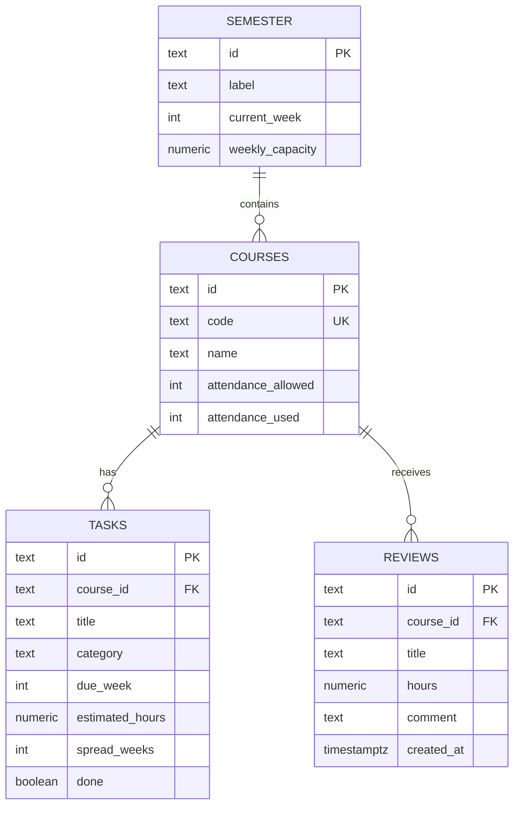

# Crunch Week — Database Design (SD2)

This is the database design deliverable for the Project Implementation grade.
It describes the tables, columns, keys and rules for the Crunch Week database,
which runs on **Postgres via Supabase**.

The design is deliberately scoped to what the app and API already send today.
Every table and column below can be traced to a field in `server/src/types.ts`
(`Semester`, `Course`, `Task`, `Review`) or to the validation in the server
(`server/src/app.ts`) and the client (`client/src/lib/`). Anything the app does
not use yet is listed in [Not in this design yet](#not-in-this-design-yet) and
left out of the tables.

---

## 1. The shapes the API already sends

The schema must round-trip these four shapes unchanged, so the client does not
have to change when the database replaces the in-memory mock.

```ts
type Semester = {
  label: string;            // "Fall 2026"
  currentWeek: number;      // 1–15
  weeklyCapacity: number;   // hours per week
  courses: Course[];
  tasks: Task[];
};

type Course = {
  id: string;               // "cs262"
  code: string;             // "CS 262"
  name: string;
  attendance: { allowed: number; used: number } | null;
};

type Task = {
  id: string;               // "262-2"
  courseId: string;
  title: string;
  category?: 'exam' | 'project' | 'problemSet' | 'reading' | 'writing' | 'homework';
  dueWeek: number;          // 1–15
  estimatedHours: number | null;
  spreadWeeks?: number;     // defaults to 1
  done: boolean;
};

type Review = {
  id: string;               // "review-1"
  courseId: string;
  title: string;
  hours: number;            // > 0 and ≤ 100
  comment: string;
};
```

---

## 2. ER diagram



---

## 3. Tables

### 3.1 `semester`

One row holds the whole semester. The app shows a single semester, so this is a
single-row table; the `id` is a fixed sentinel value.

| Column | Type | Null | Default | Notes |
|--------|------|------|---------|-------|
| `id` | `TEXT` | no | — | Primary key. Fixed sentinel, e.g. `'fall-2026'`. |
| `label` | `TEXT` | no | — | `Semester.label`, e.g. `"Fall 2026"`. |
| `current_week` | `INT` | no | — | `Semester.currentWeek`. Must be 1–15. |
| `weekly_capacity` | `NUMERIC` | no | — | `Semester.weeklyCapacity`. Must be > 0. Editable in US-32. |

**Rules**

```sql
CHECK (current_week BETWEEN 1 AND 15)
CHECK (weekly_capacity > 0)
```

### 3.2 `courses`

| Column | Type | Null | Default | Notes |
|--------|------|------|---------|-------|
| `id` | `TEXT` | no | — | Primary key. Text id, e.g. `'cs262'`. |
| `code` | `TEXT` | no | — | `Course.code`, e.g. `"CS 262"`. Unique. |
| `name` | `TEXT` | no | — | `Course.name`. |
| `attendance_allowed` | `INT` | yes | — | `Course.attendance.allowed`. Null when no policy. |
| `attendance_used` | `INT` | yes | — | `Course.attendance.used`. Null when no policy. |

**Rules**

- `attendance_allowed` and `attendance_used` are **both null or both not null**,
  matching `attendance: { allowed, used } | null`. Enforced with a table check.
- Both, when present, must be ≥ 0.

```sql
UNIQUE (code)
CHECK (attendance_allowed >= 0)
CHECK (attendance_used >= 0)
CHECK ((attendance_allowed IS NULL) = (attendance_used IS NULL))
```

### 3.3 `tasks`

| Column | Type | Null | Default | Notes |
|--------|------|------|---------|-------|
| `id` | `TEXT` | no | — | Primary key. Text id, e.g. `'262-2'`. |
| `course_id` | `TEXT` | no | — | Foreign key → `courses.id`. `Task.courseId`. |
| `title` | `TEXT` | no | — | `Task.title`. |
| `category` | `TEXT` | yes | — | `Task.category`. One of the six closed values, or null. |
| `due_week` | `INT` | no | — | `Task.dueWeek`. Must be 1–15. |
| `estimated_hours` | `NUMERIC` | yes | — | `Task.estimatedHours`. Null = not estimated. |
| `spread_weeks` | `INT` | no | `1` | `Task.spreadWeeks`. Defaults to 1. |
| `done` | `BOOLEAN` | no | `false` | `Task.done`. |

**Rules**

- `category` is a closed set, matching `client/src/lib/categories.ts`.
- `due_week` must be 1–15, matching `WEEKS_IN_SEMESTER` and the client's
  syllabus scanner.
- `estimated_hours` is null (not estimated) or strictly between 0 and 100,
  matching `MAX_ESTIMATE_HOURS` and the server's PATCH validation.
- `spread_weeks` must be ≥ 1 and no more than `due_week` (work cannot spread
  before week 1).

```sql
CHECK (category IN ('exam','project','problemSet','reading','writing','homework'))
CHECK (due_week BETWEEN 1 AND 15)
CHECK (estimated_hours IS NULL OR (estimated_hours > 0 AND estimated_hours <= 100))
CHECK (spread_weeks >= 1 AND spread_weeks <= due_week)
```

### 3.4 `reviews`

| Column | Type | Null | Default | Notes |
|--------|------|------|---------|-------|
| `id` | `TEXT` | no | — | Primary key. Text id, e.g. `'review-1'`. |
| `course_id` | `TEXT` | no | — | Foreign key → `courses.id`. `Review.courseId`. |
| `title` | `TEXT` | no | — | `Review.title`. The assignment, as in the syllabus. |
| `hours` | `NUMERIC` | no | — | `Review.hours`. Must be > 0 and ≤ 100. |
| `comment` | `TEXT` | no | `''` | `Review.comment`. Empty string when none. |
| `created_at` | `TIMESTAMPTZ` | no | `now()` | When the review was added. |

**Rules**

- `hours` must be > 0 and ≤ 100, matching the server's `POST /courses/:id/reviews`
  validation.

```sql
CHECK (hours > 0 AND hours <= 100)
```

---

## 4. The id type decision

The sample data uses **text ids** (`cs262`, `262-2`, `review-1`), and the API
sends `id` as a string. To keep the client unchanged, the database keeps
**`TEXT` primary keys** carrying those same values.

- `courses.id` = the course code slug, e.g. `'cs262'`.
- `tasks.id` = a short per-course slug, e.g. `'262-2'`.
- `reviews.id` = a generated slug, e.g. `'review-1'`.

Integer `SERIAL` ids (as in the earlier `DB Schema.md` sketch) are deferred.
They become attractive once users and login arrive (US-19 to US-21), when
surrogate keys and per-user rows make integer ids worth the mapping layer. Until
then, text ids keep the API contract byte-for-byte identical.

---

## 5. Rules match the server and the client

| Rule | Database | Server (`app.ts`) | Client |
|------|----------|-------------------|--------|
| `estimated_hours` null or 0 < h ≤ 100 | `CHECK` on `tasks` | PATCH rejects `< 0`; client caps at 100 | `MAX_ESTIMATE_HOURS = 100` |
| `due_week` 1–15 | `CHECK` on `tasks` | — | `WEEKS_IN_SEMESTER = 15`; scanner skips outside 1–15 |
| `review.hours` 0 < h ≤ 100 | `CHECK` on `reviews` | POST rejects `!(hours > 0) \|\| hours > 100` | — |
| `category` closed set | `CHECK` on `tasks` | — | `categories.ts` closed union |
| attendance both-null-or-both-set | `CHECK` on `courses` | — | `attendance: {...} \| null` |

---

## 6. Not in this design yet

These are deliberately out of scope for this design, because the app and API do
not send them yet. They are listed so the team knows they are deferred, not
forgotten.

- **Users and login** (US-19 to US-21, FR-18 to FR-20): no `students` table, no
  authentication or authorization. The app has no login today.
- **Syllabus storage** (US-22 to US-24, FR-21 to FR-23): the server parses a
  syllabus PDF but does not store it. No `syllabi` table yet.
- **Weekly difficulty prediction** (US-25, FR-24): the `weekly_difficulty`
  table from the earlier `DB Schema.md` sketch. The app computes workload from
  tasks, not from a stored per-week difficulty score.
- **Calendar feed** (input 02): no table for Moodle calendar events.
- **Semester history**: a single `semester` row; no multi-semester history.

These belong to later phases and later issues in the Supabase series. When they
land, the `DB Schema.md` sketch (students, semesters, classes, enrollments,
syllabi, weekly_difficulty) is the starting point to extend this design.
