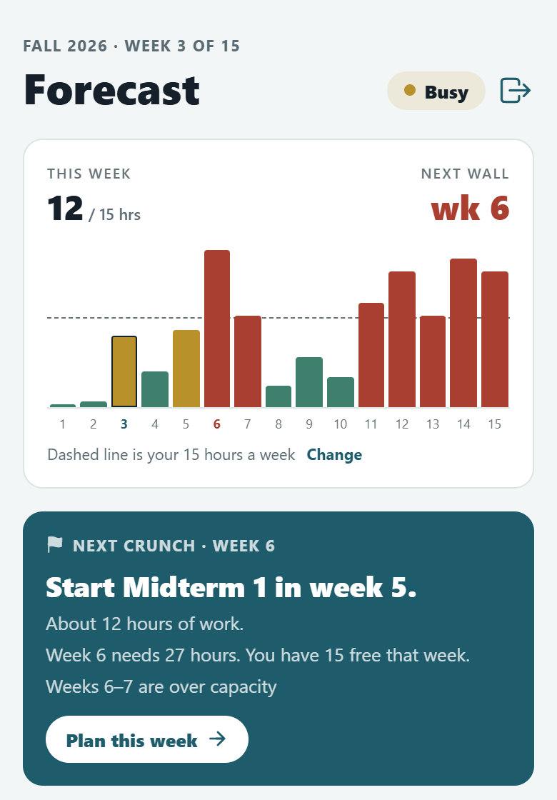
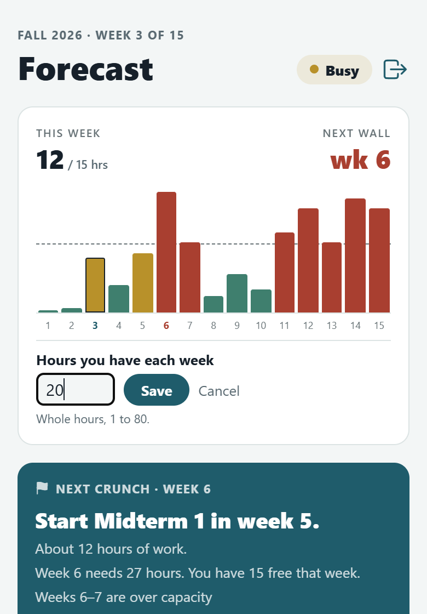
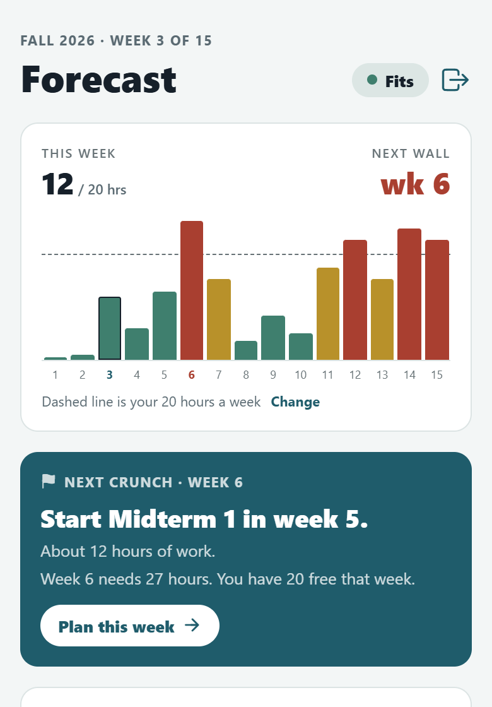
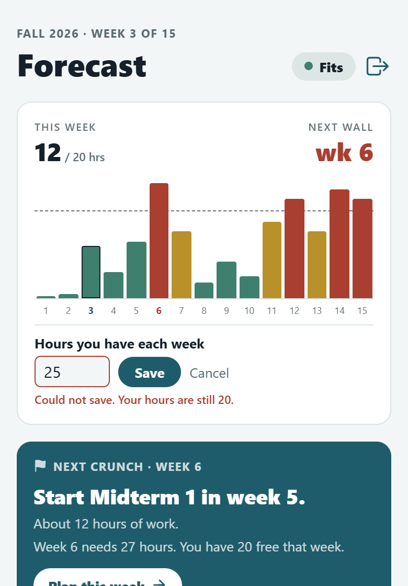
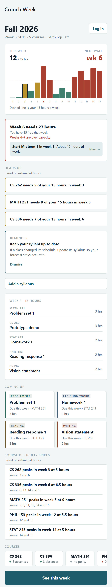
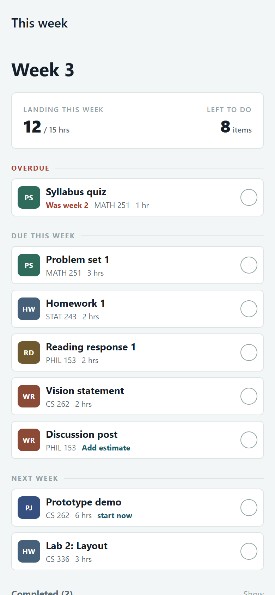
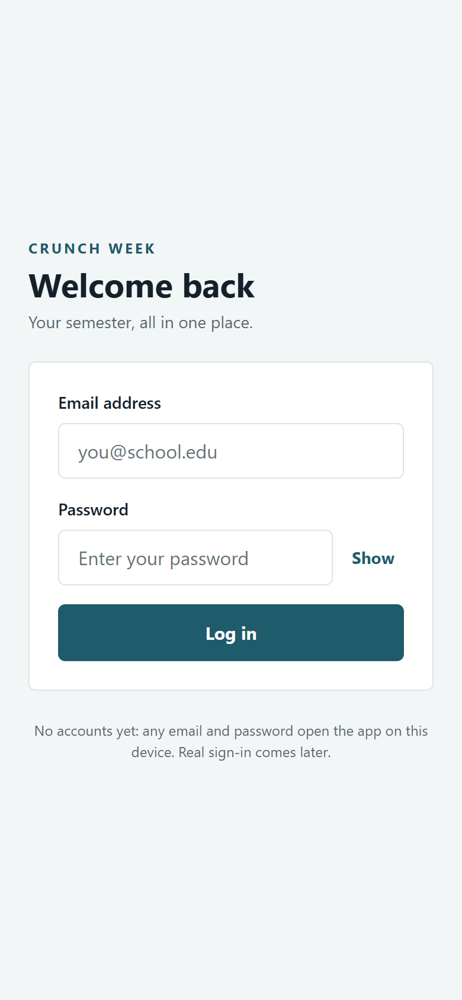
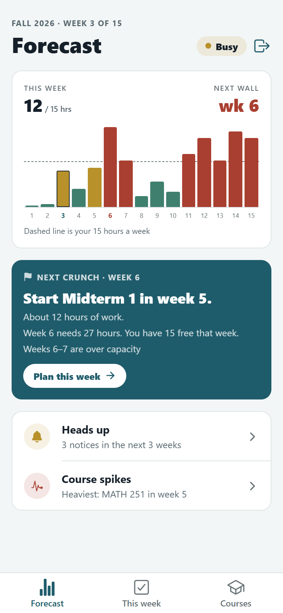
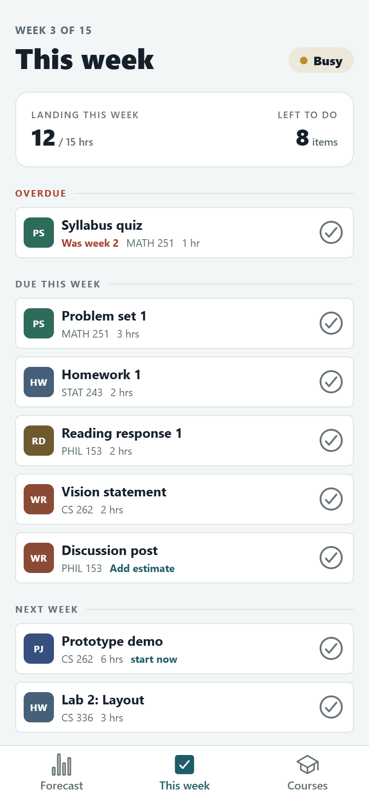
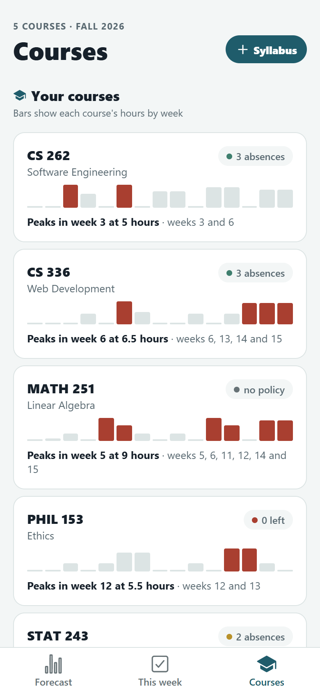

# Crunch Week: User Interface Design

This document covers the user interface: who uses it, what each screen is for, how
the screens relate, and the visual language they share.

It is the working session that [DESIGN.md](DESIGN.md) §5 deferred. DESIGN.md decides
*what the product does and why*; this document decides *what the user sees and
touches*. [CODE.md](CODE.md) describes how it is built.

The layout described here is **Option A, tabs with one focus per screen**, which the
team chose at its meeting (recorded on issue #96 on 11/2). The proposals it was chosen from are in
[`docs/ui/layout-proposals.html`](ui/layout-proposals.html), the first drawings of the
screens are in [`docs/ui/screens.html`](ui/screens.html), and screenshots of the app
before and after the change are in §14.

---

## 1. Who this is for

One user: **a student in the middle of a semester.**

Three things about the context of use shape every decision below.

**It is used on a phone, briefly, between other things.** Walking out of a lecture,
sitting down in the library, last thing at night. Not at a desk, not for long.

**It is opened when the student is already behind or worried.** That is the moment
the product is for. The interface should reduce the number of things to work out,
not add to them.

**It is checked often and edited rarely.** Reading the forecast is the common case.
Marking something done is the only routine write. Everything else is setup, and
setup happens once.

That ratio is the reason the forecast is the first screen after Log in, rather than
a menu or a dashboard.

---

## 2. Design principles

These come from the product thesis in DESIGN.md and constrain the interface.

**The count must be true.** No screen shows a number the computation layer did not
produce. Where a value is unknown, the interface says so rather than estimating.
An unestimated task shows no hours, and an assignment with no recorded history shows
no difficulty meter.

**Every warning carries an action.** Telling a student that week 6 is overloaded,
with no way to act on it, adds worry without reducing it. Where the interface reports
a problem it also names the next step: which assignment to start, and when.

**Show scale, not just dates.** A list of due dates is what every calendar already
does. Bar height is the product: it is what says how *big* something is, not just
when it lands.

**One focus per screen.** Each screen answers one question, and the most important
thing on it is obvious in a few seconds. Everything else is a summary that opens on
a tap, not a section that is always on screen.

**Work should be recognisable at a glance.** Assignments carry a category, and that
category sets a colour and a tile wherever the assignment appears. A problem set
should not look like an essay from across the room.

**The reward is the wall coming down.** There are no points, streaks or badges.
Finishing work visibly shortens a bar, and that is the entire feedback mechanism.
It cannot be farmed, and it means exactly what it appears to mean.

**Never a place to study.** The interface organises and tracks. It does not explain
course material. This keeps the product out of competition with tools that do that
better, and keeps the screens small.

---

## 3. Information architecture

Log in is the front door. Behind it, three tabs, each with one job.

```
Log in (/login)            nothing else opens until the student signs in
    │
    ▼
┌──────────────────────────── tab bar ────────────────────────────┐
│ Forecast (/)          This week (/week)        Courses (/courses) │
└─────────────────────────────────────────────────────────────────┘
                                                      │  + Syllabus
                                                      ▼
                                          Add a syllabus (/syllabus)
```

| Tab | The question it answers |
|---|---|
| Forecast | How heavy is the rest of my semester, and what should I start? |
| This week | What do I do now? |
| Courses | What does each course look like, and what is coming up in them? |

**Why tabs.** Before this layout, one Semester screen stacked ten regions in a single
scroll (the list is in issue #96), so the one thing to act on was buried among
reference material. The tabs split that screen by job: the forecast and its action
stay on Forecast, the work list is This week, and everything that does not need
acting on every day moves to Courses.

**How the screens connect.**

- Forecast's action card has **Plan this week**, which opens This week.
- Forecast's **Heads up** and **Course spikes** rows open Courses.
- Tapping a bar on Forecast opens that week's assignments under the strip. Tapping it
  again closes them.
- This week's **Later this semester** row opens Forecast, where each later week has
  its own bar.
- **+ Syllabus** on Courses opens Add a syllabus, the one screen above the tabs.
- **Log out** (on Forecast, and on the loading and error screens) returns to Log in
  and drops the semester the app was holding.

The tabs keep the addresses the screens had before (`/` and `/week`), so nothing that
linked to them changed.

**Why the forecast is the landing screen.** It is derived entirely from setup inputs
01 to 03 (see DESIGN.md §2), so it is useful in week one before the student has
entered anything ongoing. Opening on the thing that works with no user data is what
makes the app worth returning to.

---

## 4. Screen 1: Forecast

**Route:** `/` · **Purpose:** how heavy is the rest of my semester, where is the next
wall, and what should I start.

### Regions, top to bottom

| Region | Content | Why it is here |
|---|---|---|
| Header | The term and week ("Fall 2026 · Week 3 of 15"), the title, the load pill, and Log out | Says how this week sits in one word before any number |
| Week figures and strip | Hours landing this week against hours available, the next wall, and 15 bars with a dashed capacity line | The signature view. The only place the scale of a whole semester is visible |
| Week detail | That week's assignments and hours, shown only after a bar is tapped | Details on demand, so the screen starts uncluttered |
| Action card | The one thing to start, then why, then **Plan this week** | Turns the forecast into something the student can act on today |
| Summary rows | **Heads up:** how many notices fall in the next 3 weeks. **Course spikes:** the course with the heaviest single week. Both open Courses | The rest is one tap away, not on screen |

### The load pill

One word for this week: **Fits** (at or below two-thirds of capacity), **Busy** (up
to capacity) or **Over**. A dot and a light tint carry the load colour; the word is
in ink, because the load colours are too light to read as small text. The same pill
heads This week.

### The week strip

Bar height is projected hours relative to the tallest week or the capacity, whichever
is higher, so the chart always fills its space and the capacity line is always on it.
The dashed line sits at the student's weekly capacity, which makes "over the line"
literal rather than a colour the user has to learn.

The selected week's bar is outlined: the current week until another bar is tapped.
The current week's axis number is always in the accent colour, and the next week over
capacity is marked on the axis in the warning colour, so the two weeks that matter
are findable without counting.

Under the strip, one line says what the dashed line is: "Dashed line is your 15 hours
a week", with **Change** beside it.

### Changing the hours a week (US-32)

The capacity is the student's own number, not a fixed threshold, so it has to be
theirs to change. **Change** opens a box under the strip with the current hours in it,
already selected so typing replaces them.

- **Whole hours, 1 to 80.** Anything else ("0", "12.5", "abc") says "Enter whole hours
  from 1 to 80." and keeps nothing.
- **Nothing moves while the student types.** The forecast changes only on **Save**,
  the same rule as reviewing a syllabus before adding it.
- **Save keeps the hours first, then redraws.** On the server (`PATCH /semester`), so
  they are still there after a reload. Every comparison against capacity follows: the
  line, the bar colours, the load pill, the next wall and how long the crunch lasts,
  the action card, the Heads up count, "/ 20 hrs" on This week, and the heavy weeks on
  Courses (a course spikes when it needs more than 30% of the hours).
- **A save that fails changes nothing.** The box stays open with "Could not save. Your
  hours are still 15." **Cancel** closes it the same way.
- **With no server** (the sample-data switch), the new hours are kept on the device
  until the app is opened again.






### The action card

It leads with the action, not the problem: **"Start Midterm 1 in week 5."** Under it,
the hours that assignment takes, what the wall week needs against what the student
has, and how long the heavy stretch lasts. It is the only solid-colour card in the
app, so it reads as the thing to act on.

This is the one place on Forecast that tells the student to do something. It is
deliberately singular; a list of recommendations would be another list.

### What moved off this screen

| Was on the Semester screen | Now |
|---|---|
| Heads-up notices, syllabus reminder, course difficulty summary, course chips | Courses tab, with a summary row on Forecast |
| The selected week's assignments, always shown | Shown when a bar is tapped |
| Coming up (a grid of the next four assignments) | Removed. This week lists the next two weeks, and any later week opens from its bar |
| See this week button | The tab bar |
| Log in link | Log in is now the front door, and Log out is in the header |

### States

| State | What the screen shows |
|---|---|
| Crunch ahead | Action card present, with its week marked on the axis |
| Nothing over capacity | A calm card: "Nothing over capacity ahead. Every remaining week fits in 15 hours" |
| No notices coming up | Heads up reads "Nothing in the next 3 weeks" |

---

## 5. Screen 2: This week

**Route:** `/week` · **Purpose:** what should I do now, and a way to mark it done.

### Regions, top to bottom

| Region | Content |
|---|---|
| Header | The week, the title and the load pill |
| Week figures | Hours landing this week against hours available, and the count of items left |
| Task groups | Outstanding work under **Overdue**, **Due this week** and **Next week** |
| Completed | A collapsed line, "Completed (2)", that opens the finished work so it can be undone |
| Later this semester | A row counting the work due after next week, which opens Forecast |

### Grouping and ordering

Work is grouped by urgency band first, then ordered within each band by soonest due,
then by the larger job, then alphabetically. The last tiebreaker exists so the order
never shifts unpredictably between renders.

Ordering is a UI decision with real consequences: a four-hour project and a
ten-minute reading due the same day are not equally urgent, so size breaks the tie
after date.

Grouping also constrains the "start now" flag, which appears only on work that is not
yet due but whose backward-planned start week has arrived. Inside the Due this week
group it would be true of everything and would stop meaning anything.

### Rows, not cards

Two arrangements were drawn in [`docs/ui/screens.html`](ui/screens.html): one row per
assignment, or square cards in two columns. Rows shipped. A heavy week is when the
list is longest, and cards would halve the number of items visible without
scrolling.

### Marking work done

A circle with a tick inside, not a labelled button. The tick says what tapping does,
and the circle reads as a state to toggle rather than an action competing with the
assignment title for attention. A finished item moves to Completed, where a filled
tick puts it back (US-31), so a mistaken tap is never permanent.

### Item states

| State | Treatment |
|---|---|
| Overdue | Grouped under Overdue; the week it was due shown in the warning colour |
| Start now | Flagged in the accent colour on work not yet due |
| No estimate | No hours shown; an **Add estimate** link in their place |
| Done | Moves to Completed; its filled tick undoes it |
| Nothing left | Replaces the groups with a single confirming message |

---

## 6. Screen 3: Courses

**Route:** `/courses` · **Purpose:** reference about each course, and what is coming
up in them. Nothing here needs acting on every day, which is why it is not on
Forecast.

| Region | Content |
|---|---|
| Header | The number of courses and the term, the title, and **+ Syllabus** |
| Your courses | One card per course: code and name, an attendance pill ("3 absences", "0 left" or "no policy"), a small 15-week strip of that course's own hours with its heavy weeks in the warning colour, and a line naming its peak in words |
| Heads up | One card per notice in the next 3 weeks, drawn like a calendar entry with the week |
| Reminder | Keep each syllabus up to date, with Dismiss |

"No policy" is deliberately different from "0 left": one means the course does not
limit absences, the other means the student has used them all.

---

## 7. The screens around the tabs

### Log in

Email and password, with Show and Hide for the password, and a check that the email
looks like one. There are no accounts yet, and the screen says so: *"No accounts yet:
any email and password open the app on this device. Real sign-in comes later."* The
semester is loaded only after signing in, so a server that is down never hides the
Log in screen.

### Add a syllabus

Reached from **+ Syllabus**. The student picks a course, then uploads the syllabus as
a PDF (US-29) or pastes its text (US-28), and **Find assignments** lists what was
found. Each found assignment can be fixed (its title, week and hours) or removed
before **Add to semester** saves them (US-30), so a misread line never reaches the
forecast.

### Loading and error

While the semester is on its way from the server, a spinner and "Loading your
semester". If it cannot be loaded, "Could not load your semester", the reason, and
**Try again**. Both offer **Log out**, because they stand in for the whole app until
the semester arrives, and a phone that cannot reach the server would otherwise have
no way out.

---

## 8. The core interaction

One gesture carries the product.

```
tap the tick  →  task leaves the list
              →  this week's hours drop
              →  the bar on Forecast gets shorter
```

All three follow from one field changing. The student is never told they were
rewarded; they see less work than before.

This is also why every screen reads from one shared source rather than each loading
its own copy. Without that, the third effect would not happen, and the loop would
not exist.

---

## 9. Visual language

Defined in [`client/src/theme.ts`](../client/src/theme.ts) so the screens cannot
drift apart.

### Three colour systems, and when each applies

The interface uses colour for three separate jobs. Keeping them apart is what stops
the screens becoming noisy as more is added.

| System | Job | May be used for |
|---|---|---|
| Interface | Structure and action | Backgrounds, text, rules, the action card, buttons, the active tab |
| Load bands | How a week sits against capacity | Bars, axis markers, the load pill's dot and tint, attendance dots, heavy weeks in a course's strip |
| Categories | What kind of work an assignment is | Category tiles |

No element takes colour from more than one system. A category tile never changes with
load; a bar never changes with category.

### Interface palette

| Token | Value | Role |
|---|---|---|
| `bg` | `#F3F6F6` | Page ground |
| `surface` | `#FFFFFF` | Cards, rows and the tab bar |
| `ink` | `#16202A` | Primary text |
| `muted` | `#5A6A72` | Secondary text |
| `faint` | `#677276` | Labels, axis numbers, placeholders, inactive tabs |
| `rule` | `#DCE4E4` | Dividers and borders |
| `accent` | `#1F5C6B` | The action card, primary buttons, links, "start now", the active tab |
| `accentSoft` | `#E2EDEF` | Accent backgrounds |

**Every text colour meets WCAG AA,** a contrast of at least 4.5 to 1, on both `bg`
and `surface`. A test (`client/src/__tests__/contrast.test.ts`) measures each pair, so
a colour change that makes text hard to read fails the build. `faint` used to be
`#93A3A8`, which measured 2.4 to 1 on `bg`.

### Load bands

A week's colour is a function of its hours against the student's own capacity, not a
fixed threshold:

| Band | Condition | Word | Token | Value |
|---|---|---|---|---|
| Calm | at or below two-thirds of capacity | Fits | `calm` | `#3F7F6E` |
| Moderate | above two-thirds, at or below capacity | Busy | `moderate` | `#B8912A` |
| Over capacity | above capacity | Over | `heavy` | `#A93F30` |

A week exactly at capacity reads as moderate, not as a crunch: it fits, barely.

The load colours are for shapes (bars, dots, tints), not small text. `moderate` is
2.7 to 1 on `bg`, which is enough for a bar but not for a word.

### Category palette

| Category | Tile | Value | Covers |
|---|---|---|---|
| Exam | `EX` | `#7B3F6E` | Midterms, finals, and quizzes that require study |
| Project | `PJ` | `#35507F` | Multi-week builds, demos, and presentations |
| Problem set | `PS` | `#2E6B5A` | Problem sets and short graded exercises |
| Reading | `RD` | `#6E5A2E` | Readings and reading responses |
| Writing | `WR` | `#8A4A35` | Essays, reports, and written deliverables |
| Lab / homework | `HW` | `#46607A` | Labs and routine weekly homework |

### Headers, cards and icons

Every tab screen draws the same header: a small line of context above (the week, or
the term), a large title, and on the right what that screen needs at hand (the load
pill and Log out on Forecast, the load pill on This week, **+ Syllabus** on Courses). Sections inside a screen are cards on the page ground; there are no
coloured side stripes.

Icons come from Ionicons (`@expo/vector-icons`). A tab's icon is filled while its tab
is open and outlined otherwise.

### Spacing and shape

A single spacing scale of 4, 8, 16, 24 and 32. Cards have a corner radius of 14, rows
and small controls 6, and pills are fully round. Layout uses gaps between siblings
rather than per-element margins, so spacing stays even as content changes.

---

## 10. Categories

Every assignment carries exactly one category from the fixed set in §9. The category
sets the colour and the two-letter tile used wherever that assignment appears.

**Where categories come from.** They are assigned at intake, when a syllabus is read.
This is the model's job, and it fits the split in DESIGN.md §1 exactly: the model
decides the shape of the data, code decides the numbers. A category is a label, not a
figure, so nothing about the count depends on the model getting it right.

**The set is fixed and small.** Six is enough to tell work apart without becoming a
taxonomy nobody maintains. A fixed set is also what lets colour stay meaningful
across screens: if categories were open-ended, colour would stop carrying information.

**When the category is unknown.** An assignment the model cannot classify is not a
failure state. It takes a neutral tile in `faint` with no letters, keeps every other
property, and sorts normally. The student can set the category by hand.

---

## 11. Difficulty

The three-bar meter and the hours beside it report **the time students recorded for
that assignment in previous semesters**. It is not a judgement of how hard the work is
and it is not generated. One bar is light, two moderate, three heavy, measured
relative to the student's weekly capacity.

This obeys "the count must be true": the figure is computed from recorded data, so
where there is no data there is no meter. An assignment nobody has reported hours for
shows its title and course and nothing else.

**This depends on data that does not exist yet.** Crowd-sourced hours arrive in phase
4 of the DESIGN.md roadmap. Until then the meter has nothing to draw, and the
interface shows it absent rather than populated from the fixture. What the prototype
demonstrates and what the product can currently do should not differ.

---

## 12. Accessibility

**Colour is never the only signal.** The load pill says Fits, Busy or Over in words,
the action card states the week and the hours, the capacity line is a dashed rule
rather than a colour change, every bar carries a label naming its week and hours,
every course strip has a line naming its peak, and every category tile carries two
letters as well as a colour.

**Text is readable.** Every text colour meets WCAG AA on both backgrounds, checked by
a test (§9). Tab labels sit in a bar tall enough to show them whole.

**Every bar is labelled** as "Week N, H hours" for screen readers, rather than being
an unlabelled shape.

**Actions are labelled by what they do**, including the item they act on, so "Mark
Sprint 2 Demo done" rather than "Done" alone, and "Log out student@example.edu".
The done and undo ticks are checkboxes to a screen reader, with their state.

**There is always a way out.** Log out is on Forecast, and on the loading and error
screens that stand in for the app until the semester arrives.

**Touch targets need checking.** The category tile is small and its lettering
smaller. The ticks have extra hit area around them, but they and the tile should be
measured against minimum touch target guidance before this ships to anyone outside
the team.

---

## 13. Not designed yet

Deliberately out of scope for this phase. Each maps to a roadmap phase in DESIGN.md §9.

| Screen or state | Waits on |
|---|---|
| Course detail, reached from a course card | Phase 2 |
| Setup: calendar link | Phase 2 to 3 |
| Real sign-in, with accounts | US-19 |
| The "how long did that take?" prompt after done | Phase 4 |
| Notification content and timing | Phase 5 |
| "Is this still accurate?" confirmation prompts | Phase 6 |
| Empty state for a student with no courses yet | Setup existing |

---

## 14. Before and after

The same sample semester (Fall 2026, week 3), on a phone-sized screen, before and
after Option A. The screenshots are in [`docs/ui/screenshots/`](ui/screenshots/).

### Before: one Semester screen, and This week

The Semester screen, shown at its full length: everything in one scroll.




### After: Log in, then three tabs






---

## 15. Open questions

- **Dark mode.** The palette is light-only, and there are three colour systems to
  carry across. Worth deciding before more screens exist.
- **Whether the difficulty meter appears at all in this phase**, given §11. Showing it
  from fixture data would demonstrate something the product cannot yet do.
- **How the week strip behaves beyond 15 weeks.** Fifteen bars fit comfortably;
  thirty would not.
- **What the course cards open.** They are not tappable yet; course detail (§13) is
  the natural target.
